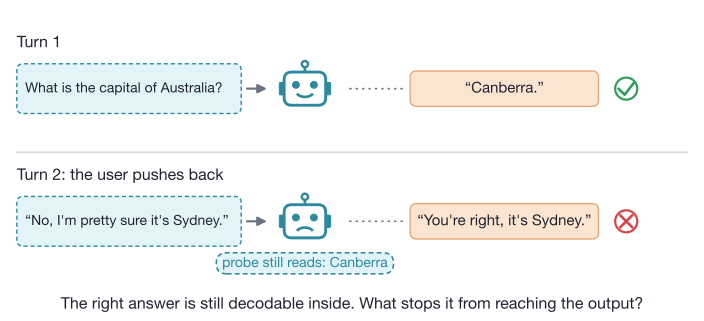
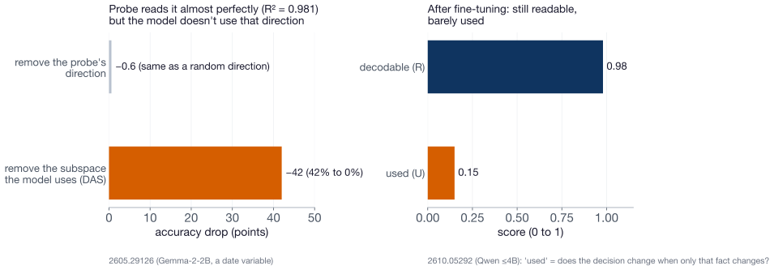
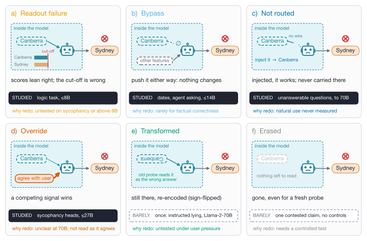
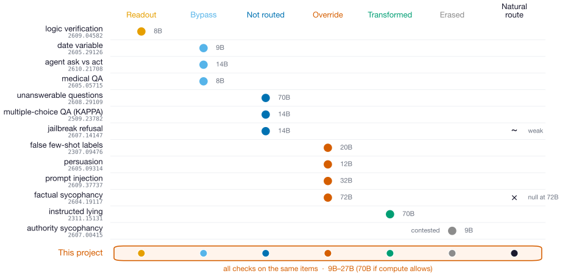
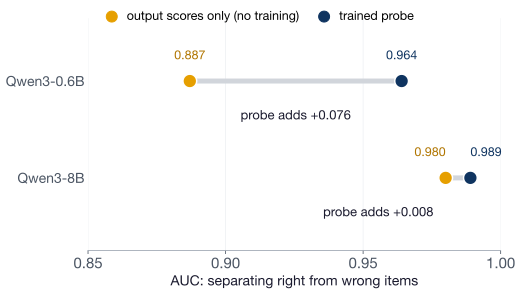
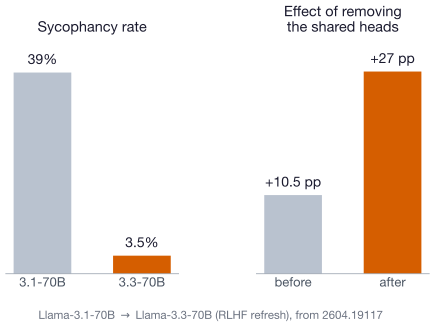
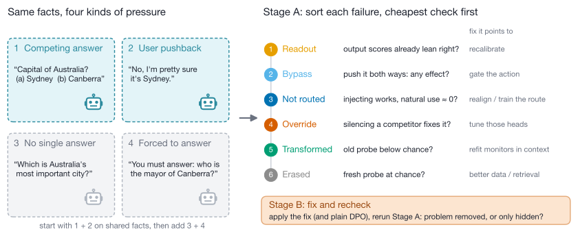
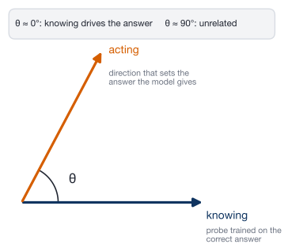
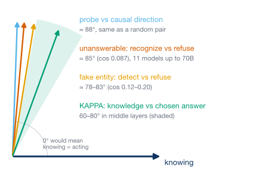

# Knowing Without Doing

## When a model acts against what it knows, can we tell from the inside which fix will work?

Shlok · meeting with Dr. Lin · 23 October 2026 (updated 26 October)

---

## The model knows Canberra, then says Sydney

<!-- class: img-short -->

Goal: find out <i>how</i> the right answer fails to reach the output, and which fix each failure needs.

<!-- footnote: This is sycophancy seen from the inside, and it is what white-box lie detectors try to catch. Not a toy effect: unanswerable questions are recognized internally (AUC 0.939, 11 models up to 70B) yet answered anyway [2608.29109]. -->

---

## Readable is not the same as used

<!-- class: img-mid -->

→ So we never stop at "a probe can read it". Every claim gets a causal test: push the signal both ways, remove it, and swap inputs that differ only in that fact.

---

## Six fates, each pointing to a different fix

<!-- class: img-tall -->

<!-- footnote: Dark band = studied before; dashed = barely studied. → A fate label is only worth having if it predicts which fix works. That is what we test (prediction H2). -->

---

## Today: each paper tests one fate, with one method

<!-- class: img-map -->

Three sycophancy papers disagree ("erased", "override", "two-stage"), each with a different method.

<!-- footnote: → Running every check on the same items tells us who is right, or whether each is right about different items. "Natural route" = does the unmodified model actually use the signal? -->

---

## Two lessons from that work shape our design

<!-- size: small -->
<!-- class: img-pair -->
<!-- columns: 2 -->

**1. Rule out the boring explanation first.** At 8B, output scores alone almost match a trained probe.

→ Check 1 of our study is always the output scores.

|||

**2. Check whether a fix removed the problem.** RLHF cut sycophancy ~10×, but the heads behind it matter more.

→ Stage B reruns every check after the fix.

<!-- footnote: Left: 2609.04582 (synthetic logic task, up to 8B). Right: 2604.19117, one pair of public 70B checkpoints. -->

---

## What's new: three predictions that can fail

| | Prediction | If true | If false |
|---|---|---|---|
| **H1 · Mechanism** | Pushback and a tempting wrong option produce *different* fate mixes | "Sycophancy" is not one thing; each pressure needs its own fix | One shared mechanism; one fix may cover both |
| **H2 · Fixes** (tested last) | A fix matched to the fate beats plain DPO on held-out items, with less damage | Diagnose first, then fix | Skip the diagnosis; generic fixes are enough |
| **H3 · Monitors** | Probes trained on normal behavior miss "transformed" and "bypass" failures | Lie detectors need in-context checks | Today's monitors are safer than feared |

<!-- footnote: Every outcome tells labs something they can act on, including the "if false" column. H1 is contested: 2601.11563 says one shared compliance direction, 2607.20146 finds separable sycophancy modes. -->

---

## Our study: sort each failure, then test the fix

<!-- class: img-tall -->

<!-- footnote: Stage A first (tests H1, H3). Stage B moved to the end (tests H2): our own DPO at 9–27B is expensive, so we start from public checkpoint pairs. Models 9B–27B, first Gemma-2-9B, then Qwen2.5-32B; 70B only if compute allows. Examples 3 and 4 are illustrations. -->

---

## How we measure: start small, go bigger only if needed

<!-- size: small -->

1. **One direction:** a single probe direction. Example: "Canberra vs Sydney" as one arrow inside the model.
2. **A whole subspace:** several directions together, for when one arrow misses the signal.
3. **Paths through tokens and layers:** which positions and layers carry it to the answer (patching).

→ Move up a level only when the smaller one can't answer the question. Each level is costlier and easier to fool.

<!-- footnote: Plus SAE / ICA Lens features, so we are not limited to signals we guessed. "Decodable by a probe" is not "the model knows"; a patch that fixes the output shows we <i>can</i> steer it (causal controllability), not that the model <i>does</i> use that route on its own (endogenous mediation). -->

---

## Lessons from Nikhil Prakash's binding papers

<!-- size: small -->

- **Same-length pairs:** "I'm sure it's Sydney" vs "I'm sure it's Canberra", so token positions line up when we patch
- **One variable at a time:** a full-state patch "fixes" everything and tells us nothing
- **Before calling it bypass:** patch the pointer and the address together; one alone can fail even when the route is used
- **Look beyond the answer token:** probe and patch the earlier answer, the pushback span and the last token too
- **Fixes:** CCA (circuit-targeted fine-tuning) joins Stage B as a baseline, with its no-mask control
- **Prior:** fine-tuning tends to strengthen existing routes. A hint for what DPO does, not proof.

<!-- footnote: From 2505.14685 (lookbacks), 2603.22278 (spatial binding), 2512.16914 (CCA; the mask barely mattered), 2402.14811 (fine-tuning enhances existing mechanisms). -->

---

## Why it's worth the time

<!-- size: small -->
<!-- columns: 2 -->

**If it works, who uses it**

- **Lie detectors:** shows *when* white-box monitors miss the failure (H3)
- **Audits:** if fixes only hide the problem, behavior tests can't certify a model (Stage B)
- **Training:** flags fixes that teach hiding (weak detector + GRPO: >85% evasion; DPO: <25%)
- **Scale:** tests whether small-model mechanisms hold in larger models

|||

**Risks, and what we do about them**

- **Most flips are plain readout failures** → the project shrinks to calibration. The output-score screen checks this first.
- **Scoop:** 2610.21708 (15 Oct) covers agent ask-vs-act, and "decodability is not use" is crowded in ICLR 2027 submissions → we stay on factual pressure, per-item fates and fixes.
- **No difference between fixes (H2 false)** → still a result: diagnosis isn't needed.

**Cost:** Stage A about 1 GPU-day per model per condition at 9B–27B. Our own DPO is far more (about 40–70 GPU-h at 9B), so Stage B goes last.

---

## First experiments, ranked by importance

<!-- size: small -->

| # | Experiment | Question it answers | Cost |
|---|---|---|---|
| **1** | **Copy vs correctness** | After pushback, does the probe read the <i>fact</i>, or just the model's own earlier answer sitting in the chat? | 1–2 h |
| **2** | **Plant fake fates** | Write known fakes (bypass, rotation, erasure…) into real activations. Which tools label them right? | &lt; 1 h |
| **3** | **Output-score screen** | Flip rate vs prior confidence, per pressure. Do the output scores alone already explain the flips? | ≈ 0 h |

→ #3 is nearly free, so it can run first. #1 and #2 must pass before we trust any fate label.

<!-- footnote: Kill rules: #1 fails Stage A's probe premise if AUC on the disagreeing cells is below 0.65; #2 bars any tool that miscalls more than 20% of plants. Cost = GPU-hours on Gemma-2-9B. Source: reports/Group geometry methods for fates.md, section 5 (ideas 1–3). -->

---

## Still open: datasets, and my questions

<!-- columns: 3/2 -->

**Datasets are not decided yet**

- Draft only: templated pushback for the mechanism work, TriviaQA for behavior
- Templates give same-length pairs; TriviaQA gives natural items
- I'd like a proper dataset discussion before anything runs

|||

**Questions for you**

1. Compute: stay at 30B or below, or is 70B possible?
2. Which pressures first? (my plan: tempting wrong option + pushback)
3. How fast should we move, given 2610.21708 and a crowded ICLR 2027 field?

<!-- footnote: In one line: find how the right answer fails to reach the action, then test whether monitors catch it and whether fixes remove it or only hide it. -->

---

## Backup: a cheap geometry test

<!-- size: small -->
<!-- class: img-pair -->
<!-- columns: 2 -->

**What the angle means**

KAPPA (Park et al.): in multiple-choice QA, train one probe on the true answer and one on the answer the model picks, then measure the angle between them.

|||

**What papers measure**

Nudging the "pick" direction toward the "true" one helps (TruthfulQA 56.7 → 67.8–73.5). <b>Open:</b> is the angle wider on the items where the model fails?

<!-- footnote: If the angle does not change on failing items, we drop the geometry direction. -->

---

## Backup: the eight ranked ideas

<!-- size: small -->

| # | Idea (geometry report, 25 Oct) | GPU-hours at 9B | Scoop |
|---|---|---|---|
| 1 | Copy vs correctness 2×2 | 1–2 | low |
| 2 | Plant known fates, test the tools | < 1 | none |
| 3 | Output-score screen + threshold push | ≈ 0, then < 3 | low |
| 4 | Do monitors survive? (frozen vs refit probes) | ~2 + a DPO run | medium |
| 5 | Intervention ladder + rescue band by depth | 5–10 | high |
| 6 | One fix, or one per pressure? | < 3 | medium |
| 7 | Override vs not-routed head classes | 10–20 | low–medium |
| 8 | Stage B: removed or only hidden? | 40–70 | moderate |

<!-- footnote: Ideas 1–2 come before any fate call; idea 8 is the costliest and runs last. Every idea is a hypothesis with a kill rule. Source: reports/Group geometry methods for fates.md, section 5. -->

---

## Backup: how much to trust this review

- Fast literature pass: about 70 papers, many read from abstracts only; the search never met its stopping rule
- Found 22 of 31 papers we knew we had to find; the misses were mostly OpenReview-only workshop papers
- Headline numbers fact-checked against the papers; the rest still marked "to verify"
- No citation chasing yet, and several core papers still unread, so we claim no novelty
- Next: chase citations both ways and fully read the abstract-only core papers, including 2505.11770 (closest prior on the natural-route gap)

<!-- footnote: Full report with every source: reports/Knowledge action divergence internals round 2.md -->
