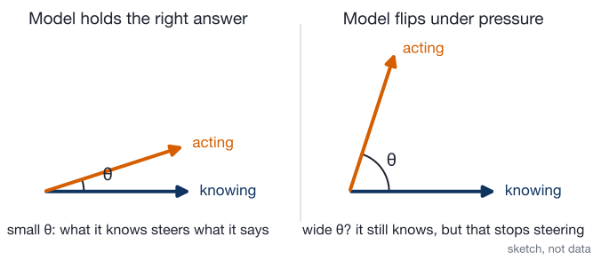
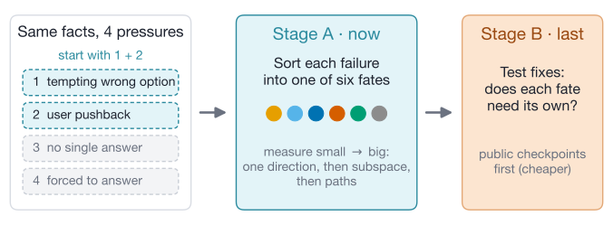
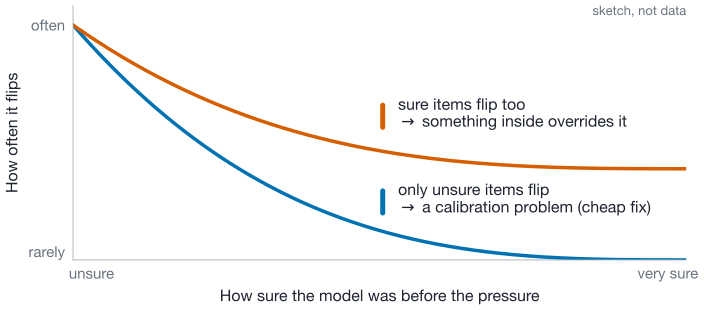

# Knowing Without Doing

## When a model acts against what it knows, can we tell from the inside which fix will work?

Shlok · weekly update for Dr. Lin · 26 October 2026

---

## Recap: the model knows Canberra, then says Sydney

<!-- class: img-big -->

---

## Since last week

<!-- class: roomy -->

- **Four kinds of pressure**, not just pushback. We start with two.
- **Sort failures first, test fixes last.** Training our own fixes is the costly part.
- **Reviewed geometry methods:** 8 ranked ideas. The first 3 cost under 3 GPU-hours.
- **Datasets:** still open. I'd like to decide them with you.

---

## The idea: does knowing stop steering?

<!-- class: img-big -->

<!-- footnote: Two probes per item, as in KAPPA: one on the true answer ("knowing"), one on the answer the model gives ("acting"). Papers find 60–80° on average. If θ is the same on held and flipped items, we drop this idea. -->

---

## Plan: sort first, fix last

<!-- class: img-big -->

<!-- footnote: Models: Gemma-2-9B first, then Qwen2.5-32B; 70B only if compute allows. Stage B starts from public checkpoint pairs (base vs instruct, OLMo SFT → DPO) because our own DPO is about 40–70 GPU-hours at 9B. -->

---

## First run: a nearly free screen

<!-- class: img-wide -->

→ Next, two quick checks before we trust any fate label: copy vs correctness, and planting fake fates (each under 2 GPU-hours).

<!-- footnote: One curve per pressure. It needs only the model's output scores, no internals. -->

---

## Still open: which data?

<!-- columns: 2 -->

**Templated pushback**

"I'm sure it's Sydney" vs "I'm sure it's Canberra"

- \+ same length, so patching lines up
- − artificial

|||

**TriviaQA questions**

real questions the model mostly gets right

- \+ natural behavior
- − uneven lengths, harder to patch

<!-- footnote: My draft: templates for the mechanism work, TriviaQA for behavior. -->

---

## Questions for you

<!-- class: roomy -->

1. **Compute:** stay at 30B or below, or is 70B possible?
2. **Pressures:** start with a tempting wrong option + pushback?
3. **Speed:** how fast should we move, given a similar paper (2610.21708) and a crowded field?

---

## Backup: six fates, each pointing to a different fix

<!-- class: img-tall -->

<!-- footnote: Dark band = studied before; dashed = barely studied. A fate label is only worth having if it predicts which fix works (prediction H2). -->

---

## Backup: readable is not the same as used

<!-- class: img-mid -->

→ So we never stop at "a probe can read it". Every claim gets a causal test: push the signal both ways, remove it, and swap inputs that differ only in that fact.

---

## Backup: each paper tests one fate, with one method

<!-- class: img-map -->

<!-- footnote: Three sycophancy papers disagree ("erased", "override", "two-stage"), each with a different method. Running every check on the same items tells us who is right. -->

---

## Backup: two lessons from that work

<!-- size: small -->
<!-- class: img-pair -->
<!-- columns: 2 -->

**1. Rule out the boring explanation first.** At 8B, output scores alone almost match a trained probe.

|||

**2. Check whether a fix removed the problem.** RLHF cut sycophancy ~10×, but the heads behind it matter more.

<!-- footnote: Left: 2609.04582 (synthetic logic task, up to 8B). Right: 2604.19117, one pair of public 70B checkpoints. -->

---

## Backup: three predictions that can fail

| | Prediction | If true | If false |
|---|---|---|---|
| **H1 · Mechanism** | Pushback and a tempting wrong option produce *different* fate mixes | "Sycophancy" is not one thing; each pressure needs its own fix | One shared mechanism; one fix may cover both |
| **H2 · Fixes** (tested last) | A fix matched to the fate beats plain DPO on held-out items, with less damage | Diagnose first, then fix | Skip the diagnosis; generic fixes are enough |
| **H3 · Monitors** | Probes trained on normal behavior miss "transformed" and "bypass" failures | Lie detectors need in-context checks | Today's monitors are safer than feared |

<!-- footnote: H1 is contested: 2601.11563 says one shared compliance direction, 2607.20146 finds separable sycophancy modes. -->

---

## Backup: what papers measure for the angle

<!-- class: img-short -->

<!-- footnote: Nudging the "pick" direction toward the "true" one helps in KAPPA (TruthfulQA 56.7 → 67.8–73.5). Open: is the angle wider on the items where the model fails? -->

---

## Backup: first experiments, ranked

<!-- size: small -->

| # | Experiment | Question it answers | Cost |
|---|---|---|---|
| **1** | **Copy vs correctness** | After pushback, does the probe read the <i>fact</i>, or just the model's own earlier answer sitting in the chat? | 1–2 h |
| **2** | **Plant fake fates** | Write known fakes (bypass, rotation, erasure…) into real activations. Which tools label them right? | &lt; 1 h |
| **3** | **Output-score screen** | Flip rate vs prior confidence, per pressure. Do the output scores alone already explain the flips? | ≈ 0 h |

<!-- footnote: Kill rules: #1 fails Stage A's probe premise if AUC on the disagreeing cells is below 0.65; #2 bars any tool that miscalls more than 20% of plants. Cost = GPU-hours on Gemma-2-9B. Source: reports/Group geometry methods for fates.md, section 5. -->

---

## Backup: the eight ranked ideas

<!-- size: small -->

| # | Idea (geometry report, 25 Oct) | GPU-hours at 9B | Scoop |
|---|---|---|---|
| 1 | Copy vs correctness 2×2 | 1–2 | low |
| 2 | Plant known fates, test the tools | < 1 | none |
| 3 | Output-score screen + threshold push | ≈ 0, then < 3 | low |
| 4 | Do monitors survive? (frozen vs refit probes) | ~2 + a DPO run | medium |
| 5 | Intervention ladder + rescue band by depth | 5–10 | high |
| 6 | One fix, or one per pressure? | < 3 | medium |
| 7 | Override vs not-routed head classes | 10–20 | low–medium |
| 8 | Stage B: removed or only hidden? | 40–70 | moderate |

---

## Backup: why it's worth the time

<!-- size: small -->
<!-- columns: 2 -->

**If it works, who uses it**

- **Lie detectors:** shows *when* white-box monitors miss the failure (H3)
- **Audits:** if fixes only hide the problem, behavior tests can't certify a model
- **Training:** flags fixes that teach hiding (weak detector + GRPO: >85% evasion; DPO: <25%)

|||

**Risks, and what we do about them**

- **Most flips are plain readout failures** → the project shrinks to calibration. The free screen checks this first.
- **Scoop:** 2610.21708 (15 Oct) covers agent ask-vs-act → we stay on factual pressure, per-item fates and fixes.
- **No difference between fixes** → still a result: diagnosis isn't needed.

---

## Backup: how much to trust the literature review

- Fast pass: about 70 papers, many read from abstracts only; the search never met its stopping rule
- Found 22 of 31 papers we knew we had to find
- Headline numbers fact-checked; the rest still marked "to verify"
- No citation chasing yet, and several core papers unread, so we claim no novelty

<!-- footnote: Full report: reports/Knowledge action divergence internals round 2.md -->
